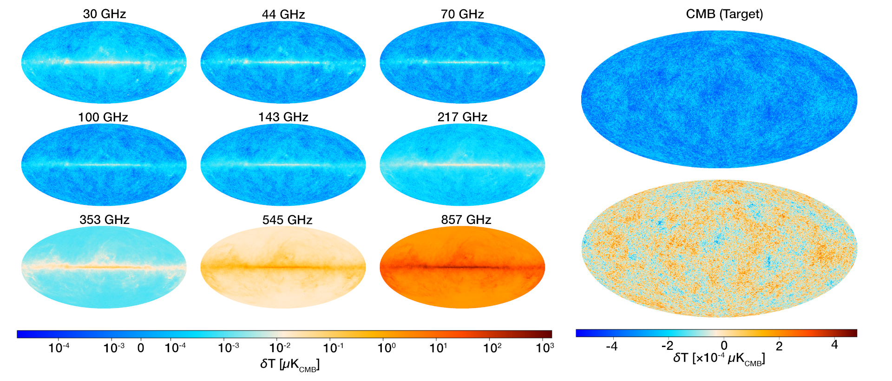

# CMB-ML: A Cosmic Microwave Background Radiation Dataset for Machine Learning

Contents:
- [Quick Start](#quick-start)
- [Introduction](#introduction)
  - [Simulation](#simulation)
  - [Baseline Models](#baseline-models)
  - [Metrics](#metrics)
- [Installation](#installation)
- [Demonstrations](#Demonstrations)
- [Comparing Results](#comparing-results)
  - [Outside Works](#outside-works)
  - [Errata](#errata)
- [Data File Links](#data-file-links)
- [Simulation Dataset: I_512_1850_UnifWMAP_Wide](#prd-simulation-dataset-i_512_1850_unifwmap_wide)

# Quick Start

To get started:
- Get this repository
- Set up your Python environment
- Create datasets (Downloading is usually an option; contact the authors of the repository if needed)
- Train models
- Run inference
- Compare results

See [Installation](#installation) and [Demonstrations](#Demonstrations) for more detail.


# Introduction


The Cosmic Microwave Background radiation (CMB) signal is one of the cornerstones upon which modern cosmologists understand the universe. The signal must be separated out from these other natural phenomena which either emit microwave signals or change the CMB signal itself. Modern machine learning and computer vision algorithms are seemingly perfect for the task, but generation of the data is cumbersome and no standard public datasets are available. Models and algorithms created for the task are seldom compared outside the largest collaborations. 

The CMB-ML dataset bridges the gap between astrophysics and machine learning. It handles simulation, modeling, and analysis.

This is somewhat complicated. We hope that the structure of CMB-ML gives you an opportunity to focus on a small portion of the pipeline. For many users, we expect this to be the modeling portion. Several examples are presented, showing how different methods can be used to clean the CMB signal. Details are provided below and in ancilliary material for how to acquire the dataset, apply a cleaning method, and use the analysis code included.

Other portions of the pipeline may also be changed. Simulated foregrounds can be changed simply with different parameters for the core engine. With more work, alternative or additional components can be used, or the engine itself can be changed out. A couple noise models particular to the Planck mission have been developed. At the other end of the pipeline, the analysis methods can be altered to match different methods. We are currently improving this portion of the pipeline.

A goal of this project has been to encapsulate the various stages of the pipeline separately from the operational parameters. It is our hope that this enables you to easily compare your results with other methods.

Several tools enable this work. [Hydra](https://hydra.cc/) is used to manage manage a pipeline so that coherent configurations are applied consistently. It uses the [PySM3](https://pysm3.readthedocs.io/en/latest/) simulation library in conjunction with [CAMB](https://camb.info/), [astropy](https://www.astropy.org/), and [Healpy](https://healpy.readthedocs.io/en/latest/) to handle much of the astrophysics. Three baselines are implemented, with more to follow. One baseline comes from astrophysics: [PyILC](https://github.com/jcolinhill/pyilc)'s implementation of the CNILC method. Another baseline uses machine learning: [cmbNNCS](https://github.com/Guo-Jian-Wang/cmbnncs)'s UNet8. A third is a simple [PyTorch](https://pytorch.org/) UNet implementation intended to serve as a template. The analysis portion of the pipeline uses a few simple metrics from [scikit-learn](https://scikit-learn.org/stable/) along with the astrophysics tools.

## Simulation



The real CMB signal is observed at several microwave wavelengths. To mimic this, we make a ground truth CMB map and several contaminant foregrounds. We "observe" these at the different wavelengths, where each foreground has different levels. Then we apply instrumentation effects to get a set of observed maps. The standard dataset is produced at a low resolution, so that many simulations can be used in a reasonable amount of space.

# Installation

Installation of CMB-ML requires setting up the repository, then getting the data assets for the portion you want to run. Demonstrations are available with practical examples. The early ones cover how to set up CMB-ML to run on your system.

<!-- NEW INSTRUCTIONS: -->
- Assuming you install all your repos in the same directory, e.g. `~/repos/`
    - Go to that folder `cd ~/repos`
- Get the latest PySM3
    - The version installed by conda is a few updates behind, including one that fixes a bug in CMBLensed
    - If not yet acquired:
        - `cd ~/repos`
        - `git clone https://github.com/galsci/pysm.git`
    - If acquired, update it:
        - `cd ~/repos/pysm`
        - `git pull`
- Download the CMB-ML repository
    - `cd ~/repos` (or whatever top-level repo folder you use)
    - `git clone git@github.com:CMB-ML/cmb-ml.git`
    - `cd cmb-ml`
    - `git switch whatever`
- Create the conda environment 
    - remove old conda installations (and Poetry... which can be gotten rid of as a whole)
        - `conda env remove -n cmb-ml`
    - still required due to either namaster or torch... this could be fixed soon, possibly
    - `conda env create -f env.yaml`
    - To change the name of the environment, edit the file or use a different command.
- Activate the conda environment
    - `conda activate cmb-ml`
- Install CMB-ML
    - `which pip` (ensure that the response is within the conda environment)
    - `pip install .` OR
    - `pip install -e .` (if you expect to want to update the cmbml code, recommended currently/internally while under extensive development)
    - I have noticed that VS Code does not work well with code installed in editable mode; I will often switch between the modes using:
      - `pip uninstall cmbml`
- Install pysm3
    - `cd ~/repos/pysm` (substitute as needed)
    - `pip install .`

Tutorial notebooks are in https://github.com/CMB-ML/cmb-ml-tutorials.git.
The PatchNN method is https://github.com/CMB-ML/cmb-ml-patch-nn.git
The cmbNNCS method is https://github.com/CMB-ML/cmb-ml-cmbnncs.git.
The PyILC method is https://github.com/CMB-ML/cmb-ml-pyilc.git.

## Notes on Running Simulations

- Generating the set of simulations takes considerable time, due to the large number.
- Downloading them is likely to be faster.
- When generating simulations for the first time, [PySM3](https://pysm3.readthedocs.io/en/latest/) relies on [astropy](https://www.astropy.org/) to download and cache template maps.
  - These will be stored in an `.astropy` directory.
  - Downloading templates is sometimes interrupted resulting in an error and the code crashing. It is annoying and beyond our control. However, because the templates are cached, the pipeline can be resumed and will proceed smoothly.

# Data File Links

We provide links to the various data used. Alternatives to get this data are in `get_data` and the `Demonstrations`. "Science assets" refers to data created by long-standing cosmological surveys.

- Science assets
  - From the source
    - Planck Maps
      - Planck Collaboration observation maps include variance maps needed for noise generation:
        - [Planck Collaboration Observation at 30 GHz](https://irsa.ipac.caltech.edu/data/Planck/release_3/all-sky-maps/maps/LFI_SkyMap_030-BPassCorrected_1024_R3.00_full.fits)
        - [Planck Collaboration Observation at 44 GHz](https://irsa.ipac.caltech.edu/data/Planck/release_3/all-sky-maps/maps/LFI_SkyMap_044-BPassCorrected_1024_R3.00_full.fits)
        - [Planck Collaboration Observation at 70 GHz](https://irsa.ipac.caltech.edu/data/Planck/release_3/all-sky-maps/maps/LFI_SkyMap_070-BPassCorrected_1024_R3.00_full.fits)
        - [Planck Collaboration Observation at 100 GHz](https://irsa.ipac.caltech.edu/data/Planck/release_3/all-sky-maps/maps/HFI_SkyMap_100_2048_R3.01_full.fits)
        - [Planck Collaboration Observation at 143 GHz](https://irsa.ipac.caltech.edu/data/Planck/release_3/all-sky-maps/maps/HFI_SkyMap_143_2048_R3.01_full.fits)
        - [Planck Collaboration Observation at 217 GHz](https://irsa.ipac.caltech.edu/data/Planck/release_3/all-sky-maps/maps/HFI_SkyMap_217_2048_R3.01_full.fits)
        - [Planck Collaboration Observation at 353 GHz](https://irsa.ipac.caltech.edu/data/Planck/release_3/all-sky-maps/maps/HFI_SkyMap_353-psb_2048_R3.01_full.fits)
        - [Planck Collaboration Observation at 545 GHz](https://irsa.ipac.caltech.edu/data/Planck/release_3/all-sky-maps/maps/HFI_SkyMap_545_2048_R3.01_full.fits)
        - [Planck Collaboration Observation at 847 GHz](https://irsa.ipac.caltech.edu/data/Planck/release_3/all-sky-maps/maps/HFI_SkyMap_857_2048_R3.01_full.fits)
      - For the mask:
        - [Planck Collaboration NILC-cleaned Map](https://irsa.ipac.caltech.edu/data/Planck/release_3/all-sky-maps/maps/component-maps/cmb/COM_CMB_IQU-nilc_2048_R3.00_full.fits)
      - WMAP9 chains for CMB simulation:
        - [WMAP9 Chains, direct download](https://lambda.gsfc.nasa.gov/data/map/dr5/dcp/chains/wmap_lcdm_mnu_wmap9_chains_v5.tar.gz)
      - Planck delta bandpass table:
        - [Planck delta bandpass table, from Simons Observatory](https://github.com/galsci/mapsims/raw/main/mapsims/data/planck_deltabandpass/planck_deltabandpass.tbl)
      - CMB-ML delta bandpass table:
        - [Original delta bandpass table, from Simons Observatory](assets/delta_bandpasses/CMB-ML/cmb-ml_deltabandpass.tbl)
          - CMB-ML modifies these instrumentation properties
        - Simply move the CMB-ML directory contained in assets/delta_bandpasses to your assets folder (as defined in e.g., [your local_system config](cfg/local_system/generic_lab.yaml))
      - [Downloading script](./get_data/get_assets.py)
  - On Box: 
    - [All Science Assets](https://utdallas.box.com/v/cmb-ml-science-assets)
    - Script to be replaced if needed. Please send a message if so.
    <!-- - [Downloading script](./get_data/get_assets.py) -->

- Datasets
  - **I_512_1850_UnifWMAP_Wide:** see [download and extraction instructions](#prd-simulation-dataset-i_512_1850_unifwmap_wide).
  - CMB_ML_512_1450
    - Individual files: [Box Link, CMB_ML_512_1450](https://utdallas.box.com/v/cmb-ml-512-1450)
      - Each simulation instance is in its own tar file and will need to be extracted before use
      - The power spectra and cosmological parameters are in Simulation_Working.tar.gz
      - Log files, including the exact code used to generate simulations, are in Logs.tar.gz. No changes of substance have been made to the code in this archive.
      - A script for these download is available [here](./get_data/get_dataset.py)
  - CMB_ML_128_1450
    - Lower resolution simulations ($\text{N}_\text{side}=128$), for use when testing code and models
    - Individual instance files: [Box Link, CMB_ML_128_1450](https://utdallas.box.com/v/cmb-ml-128-1450)
    - A script for these download is available [here](./get_data/get_box_CMB_ML_128_1450.py)
    - Change [cfg/pipeline/pipe_sim.yaml](./cfg/pipeline/pipe_sim.yaml) to use the correct set of shared links. In this yaml, look for download_sims_reference and change the path_template (replace '512' with '128').

  - Files are expected to be in the following folder structure, any other structure requires changes to the pipeline yaml's:
```
└─ Some Particular Dataset (e.g., I_512_1450)
   ├─ Simulations
   |   ├─ Train
   |   |     ├─ sim0000
   |   |     ├─ sim0001
   |   |     └─ etc...
   |   ├─ Valid
   |   |     ├─ sim0000
   |   |     ├─ sim0001
   |   |     └─ etc...
   |   └─ Test
   |         ├─ sim0000
   |         ├─ sim0001
   |         └─ etc...
   └─ Simulation_Working
       ├─ Simulation_B_Noise_Cache
       ├─ Simulation_C_Configs            (containing cosmological parameters)
       └─ Simulation_CMB_Power_Spectra
```

- Trained models
  - CMBNNCS
    - [UNet8 trained on CMB_ML_512_1450, at various epochs](https://utdallas.box.com/v/ml-cmb-UNet8-IQU-512-1450-bl)

# Simulation Dataset: I_512_1850_UnifWMAP_Wide

This dataset is distributed as **222 uncompressed `.tar` shards** on [UT Dallas Box](https://utdallas.box.com/s/tvq6c72fj2t4lgkqdbh13dvn310da047). It includes the existing simulation and working data. The shards do not need to be repackaged or regenerated to use the released dataset.

The command-line downloader requires **Python 3 and [rclone](https://rclone.org/install/)** on your `PATH`. **No Box account, Box sign-in, or configured rclone remote is required.** All commands below are run from the **root of this CMB-ML repository**. The dataset is downloaded outside the repository.

**Download** (approximately **877 GiB** of archives plus small metadata files):

```bash
python3 get_data/download_unifwmap_wide.py \
    --manifest assets/CMB-ML/UnifWMAP_Wide_download_manifest.json \
    --dest ~/CMB_Data/UnifWMAP_Wide_shards \
    --progress
```

The downloader retrieves the 222 shards, their `.complete.json` sidecars, and `shard_plan.json`, `manifest.jsonl`, and `SHA256SUMS`. It validates the size of each downloaded file and verifies the shards against their published SHA-256 hashes. It may be rerun after interruption: previously downloaded files are checked and skipped when valid; an interrupted **individual shard download starts again**, rather than resuming at a byte offset.

**Extract** to the dataset directory (requiring approximately **877 GiB** more disk space):

```bash
python3 get_data/extract_tar_shards.py \
    ~/CMB_Data/UnifWMAP_Wide_shards \
    ~/CMB_Data/I_512_1850_UnifWMAP_Wide \
    --progress-interval 5
```

The extractor checks the shard hashes and validates extracted members against the manifest. Its destination argument is the **exact restored dataset directory**; it recreates the contents of the original dataset inside that directory. Extraction can be restarted using the same command. If retaining both downloaded shards and extracted data, plan for **at least ~1.8 TiB of free disk space**, plus filesystem overhead.

To download just one file, use `--only` with its exact filename; for example, replace the download command above with the following small metadata test:

```bash
python3 get_data/download_unifwmap_wide.py \
    --manifest assets/CMB-ML/UnifWMAP_Wide_download_manifest.json \
    --dest ~/CMB_Data/UnifWMAP_Wide_test \
    --only SHA256SUMS
```

The public Box folder, the download manifest, and these two utilities are for **`I_512_1850_UnifWMAP_Wide` only**. Earlier datasets, including those used for the ICCV work, retain their existing download instructions and the original [`get_data/get_dataset.py`](./get_data/get_dataset.py) implementation.

# ICCV 2025

The ICCV2025 version of this repository is available at https://github.com/CMB-ML/cmb-ml/releases/tag/v0.1.1-iccv2025

It references two different datasets, one at Nside=512 and the other, for smoke testing, at Nside=128.